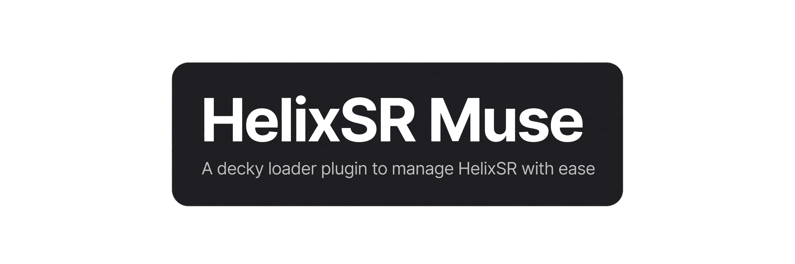
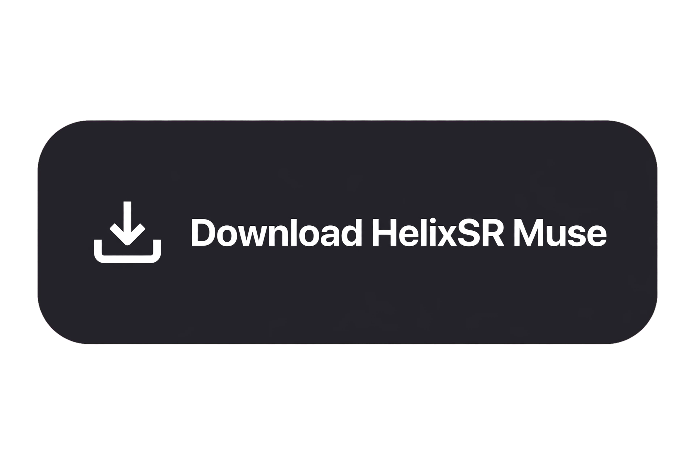

# HelixSR Muse Plugin



<a href="https://github.com/enzodiloreto/helixsr-decky-plugin-muse/releases"></a>

A [Decky Loader](https://github.com/SteamDeckHomebrew/decky-loader) plugin that manages
[HelixSR](https://github.com/lonewolf0622/HelixSR) (upscaling on AMD GPUs, built from
NVIDIA's DLSS model): pick a release, download it with a progress bar, build its
network (optionally with frame generation), and install it into compatible games —
FSR 3.1 titles get the drop-in, DLSS/XeSS/FSR2-only titles get HelixSR Scaler —
all from the Quick Access menu. Works with HelixSR 1.9.0+ and older releases;
each game's settings follow the HelixSR that installed it.

Game detection and install/uninstall run HelixSR's own reference logic: releases
up to 1.8.1 use the vendored copy in `py_modules/helixscan.py` (Apache-2.0),
while 1.9.0+ runs its own unmodified `setup/helixsr_install.py` from the
downloaded version (its Freeware license forbids vendoring). The network build
runs each release's own `helixsr-setup.sh` unmodified.

Tested on Steam Deck LCD running CachyOS and Steam Machine Running SteamOS.

## Install

On your Deck (or desktop Steam with Decky), Decky > Settings > Developer >
**Install Plugin from ZIP File**, using the zip attached to a
[release](https://github.com/enzodiloreto/helixsr-decky-plugin-muse/releases)
(or URL-install it from the release download link). Afterwards the plugin updates
itself from its panel: confirm Decky's install popup and it downloads, installs
(with proper permissions even for root-owned installs) and hot-reloads — no
Developer settings trip, no restart. (If Decky's installer is unreachable, it
falls back to the in-place or manual-zip flows.)

Upgrading from ≤ v0.0.14 (named *HelixSR-Decky-Plugin-Muse*)? Install the new zip —
it appears as *HelixSR Muse Plugin* and carries your settings and downloads over
automatically on first run. Then uninstall the old entry.

## Use

The panel walks Version → Build → Games → Scaler, with a status line and current step shown on top:

1. **Version** — pick a HelixSR release (update badge + release notes included),
   **Download** it (progress bar with MB/MB, %, speed and ETA), then **Switch to** /
   **Remove** it. **Reload releases** retries failed fetches.
2. **Network build** — **Check build readiness** first (Proton/Wine, Python + numpy,
   disk space; runs automatically before every build), then **Build network** or
   **Rebuild network**. The build downloads NVIDIA's DLSS DLL once (~56 MB, used to
   generate the network, then deleted), then compiles shaders through Proton/Wine's
   DXC — expect several minutes; the Log streams progress with a % bar. On 1.9.0+
   an experimental **frame generation** toggle adds the FG build (extra ~400 MB of
   SDK/driver downloads, needs `zstd` or Python 3.14); without it FG is skipped.
   The version line reports whether FG is actually built.
3. **Games** — **Scan games** walks your Steam libraries (1.9.0+ also covers other
   stores) for DLSS / XeSS / FSR titles (the last scan is remembered, incl. install
   states; scans run in the background and can be cancelled). On older HelixSR, pick
   the install way per game (FSR 3.1 drop-in, OptiScaler, or the experimental DLSS
   loader); on 1.9.0+ the drop-in is the only way and the picker hides for
   single-option games. **Install in / Remove from** each game, **Install/Remove
   all** at once (games without FSR 3.1 are skipped with a note instead of aborting
   the batch), or **Migrate** every outdated game to the active build in one go
   (scaler installs migrate too). Per-game **Settings** edit `helixsr.ini` inline —
   the editor follows the installing HelixSR's template (1.9.0+: no game slider,
   `WaveSize` auto, Sharpness default 0.1) — with named **presets** (save/apply/
   delete with two-tap delete, plus a built-in **Default** that resets to defaults;
   presets translate across HelixSR generations) and a per-game **Log** viewer
   offering one-tap fixes for known patterns. **Verify installs** detects games a
   Steam update broke, with one-tap **Repair**. A filter narrows big libraries,
   collapsible Installed / Not-installed groups keep long lists manageable, and a
   status filter (incl. Needs repair) jumps straight to them. Per-game **Details**
   show folder, detected inputs, FSR DLLs, exe folder and installed builds. Extra
   non-Steam folders can be added by path.
4. **HelixSR Scaler** — for games with DLSS/XeSS/FSR2 but no FSR 3.1: download the
   Scaler (~132 MB, its own releases), then install it per eligible game (two-tap
   confirm — never in online games or games with anti-cheat). The panel shows the
   per-game Steam launch options with a copy button (paste them yourself: Steam
   offers no API for that); the in-game menu opens with Insert (map a Deck back
   button to it). Scaler settings (`Int8`, `WaveSize`, `FrameGeneration`) get their
   own mini-editor; its log (`OptiScaler.log`) joins the per-game Log viewer.
5. **Storage** — per-version disk use, remove-all-except-active (refuses versions
   games still use), clear cached SDK files, and full **Reset everything**.
6. **Health** — one screen for releases reachable, versions healthy, games
   verified, disk space and plugin update state.
7. **Log** — every failure surfaces its actual reason here instead of failing
   silently; destructive actions ask for a second tap to confirm.

Requirements for building: any Proton installed in Steam (for the shader compiler)
and ~1 GB free (~1.5 GB with frame generation). Game installs only touch files
inside each game's folder (originals are kept as `*.original.dll` / `HelixSR/backup`).

## Troubleshooting

- **Empty release list**: the Log shows why (no network, GitHub rate limit, TLS
  error). **Reload releases** retries without reopening the panel.
- **"UI vX but backend vY" warning**: a partial update — tap **Reload plugin**
  in the banner first (heals it without reinstalling in most cases); if it
  persists, reinstall the zip and restart Decky.
- **Build fails**: the Log names the step. Handled automatically so far: a system
  Python without SSL support (the plugin downloads NVIDIA's DLL itself and passes
  it via `--dlss`), missing executable bits on extracted files (repaired).
- **Scan takes minutes**: normal on large libraries; backgrounded, cancellable,
  and reused for installs for 5 minutes. Rescan after adding games, switching
  versions, or changing anything outside the plugin.
- **Decky's install popup stalls mid-update**: Decky reports install progress to a
  plugin-store counter first; if that request hangs, the popup parks and never
  finishes. Dismiss it and retry — or use the plugin's own backend update flow.
- **Scaler: no menu on Insert**: the Steam launch options are missing or mistyped
  (copy them from the game's card). On Deck, map a back button to Insert in the
  game's controller settings. Never use Scaler in online or anti-cheat games.

## Develop

```bash
pnpm i                 # pnpm v9
pnpm run build         # frontend -> dist/ (prebuild stamps src/version.ts)
pnpm test              # backend unittest (stdlib only) + frontend UI tests
```

Release zips (`out/helixsr-muse-plugin-vX.Y.Z.zip`) contain exactly:
`LICENSE`, `README.md`, `dist/index.js`, `main.py`, `package.json`, `plugin.json`,
`py_modules/` (`.keep`, `cacert.pem`, `helixscan.py`, `helixref.py`, `settings.py` —
no sourcemaps, no tests). Bump `package.json` before every release.
